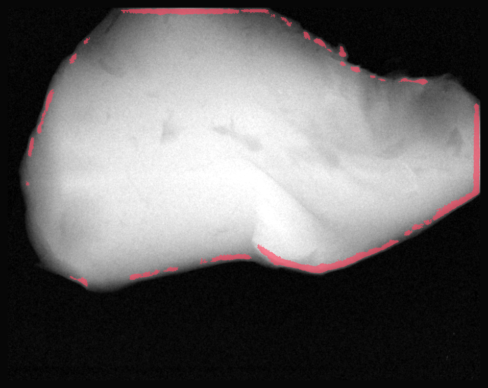

# CWI Learning Lab

**입력 → 실제 고정 모델 추론 → 오경보 검토**를 연결한 CPU 학습 프로젝트입니다.

> **NOT_DEPLOYED · AI_ASSISTED · USER_COMPETENCY_NOT_ASSESSED**  
> 의료 진단·식품 안전 판정·생산 검사에 사용하지 마세요. 기존 두 모델은 검증 정상 영상 **10/10에 경보**를 냈습니다. 성능 개선이나 일반화 성공을 주장하지 않습니다.

## 바로 실행 — Python 3.12, GPU 불필요

ZIP을 풀고 이 README가 있는 폴더에서 실행합니다. 아래는 macOS/Linux 예시입니다.

```bash
python3.12 -m venv .venv
source .venv/bin/activate
python -m pip install -r requirements-dev.txt
python -m pytest -q
python app.py
```

Windows PowerShell: `py -3.12 -m venv .venv` 다음 `.\.venv\Scripts\Activate.ps1`를 사용합니다. 설치 명령은 같습니다. 실행 후 **http://127.0.0.1:7860** 에 접속합니다. 외부 공유 링크는 생성하지 않습니다.

1. `Synthetic`는 실제 X-ray가 아닌 파이프라인 점검용 배열입니다.
2. `CWI TRAIN • normal`은 실제 공개 **훈련** 예제입니다. 추론 실행 후 빨간 경보가 왜 오경보인지 확인할 수 있습니다.
3. 업로드는 대응하는 40/90 kV **signed float32 TIFF**만 받습니다. PNG/JPEG로 바꾼 사진은 거절합니다. 개인정보·비공개/KAMP 파일은 업로드하지 마세요.

모든 단계는 AI가 구현·검증한 산출물입니다. 사용자의 직접 실행·수정 능력을 평가했다는 뜻이 아닙니다. [쉬운 해설](docs/learning/README.md)은 선택적으로 읽을 수 있으며 실행을 막는 과제나 질문이 아닙니다.

## CLI도 실제 계산합니다

```bash
python -m cwi_lab.cli --example synthetic --out artifacts/local_run
python -m cwi_lab.cli --example normal --out artifacts/local_run
python -m cwi_lab.cli --example bone --model low --out artifacts/local_run
# 본인이 사용할 권한이 있는 공개 TIFF의 로컬 경로만 사용:
python -m cwi_lab.cli --low low.tiff --high high.tiff --model dual --out artifacts/local_run
```

출력: `summary.json`, `review.png`, `alarm_mask.png`. CLI가 경로를 받는 것은 로컬 명령 사용자에게만 허용됩니다. 웹 앱은 임의 경로/URL 입력을 받지 않고 업로드 바이트만 처리합니다.

## 무엇이 실제로 들어 있나

- 과거 동결된 low/dual 로지스틱 모델의 **동일한 JSON 계수**; 재학습 없음, pickle 없음.
- 원본 signed float32, 9/31 반사경계 국소 평균, 표준화, logistic score, **전체 이미지 추론**.
- 기본 score ≥ 0.5 → 8-연결 성분 면적 ≥ 25 pixels. 점수는 모집단 확률로 보정되지 않았습니다.
- 정답 마스크는 추론 **후 검토에만** 쓰며 ROI/특징/문턱값 선택에 쓰지 않습니다.
- 입력 크기·차원·NaN/Inf·다중 페이지·dtype·짝 영상 크기 일치 검사(물리적 정합 보장 아님). 모델/예제 SHA-256 검사.
- 단위 테스트, 실제 CLI 출력, [모델 카드](docs/MODEL_CARD.md), [데이터 카드](docs/DATA_CARD.md), [보안 범위](docs/SECURITY.md).



위 그림은 CWI 훈련 정상 예제 Original 006의 실제 계산 결과입니다. 기본 dual 모델의 경보 13,617 pixels 모두 FP입니다. **훈련 예제 설명이지 새로운 검증 결과가 아닙니다.**

## 결과 해석

| 표시 | 의미 |
|---|---|
| 빨강 (정답 없음) | 모델 경보. FP라고 단정할 수 없음 |
| 빨강 / 초록 / 파랑 (훈련 정답 있음) | FP / TP / FN |
| NO ALARM | 경보 없음일 뿐 안전·정상 보증 아님 |
| EXPLORATORY_NOT_VALIDATED | 문턱값/면적 변경. 기존 검증보다 개선됐다는 증거 아님 |

표시용 1/99 percentile 대비는 추론 입력을 바꾸지 않습니다. 합성 예제 결과는 현실 성능의 증거가 아닙니다. `artifacts/`에는 AI가 수행한 예제 실행 영수증이 있습니다.

## 배포 상태와 비용

**외부 배포하지 않았습니다.** 로컬 서버 점검과 Hugging Face 온라인 서비스 배포를 구분합니다. README front matter 및 requirements는 Gradio Space용 형식으로 준비되어 있으나 원격 빌드·계정 적격성은 확인하지 않았습니다: **HF_NOT_DEPLOYED / ACCOUNT_ELIGIBILITY_UNKNOWN**.

공개 호스팅의 계정 자격·요금·보안 조건은 실제 배포 전에 별도로 확인해야 합니다. 이 스냅샷은 로컬 실행용이며 공개 저장소 게시와 실행 서비스 배포는 별개입니다. 계정 생성·구독·유료 자원·외부 업로드를 수행하지 않았고 GitHub Actions 워크플로도 포함하지 않습니다.

## CPU 프로파일 (별도 실행 증거)

`python scripts/profile_cpu.py`는 공개 TRAIN Original006 한 쌍에서 모델별 워밍업 1회 후 고정 5회만 측정합니다. 이 실행 환경의 중앙값은 low **32.43 ms**, dual **57.88 ms**였습니다. OpenBLAS 1스레드가 관측됐습니다. TIFF 읽기·UI·그림·네트워크 시간은 제외했고, 단일 머신·한 입력에 대한 기록이므로 현장 지연시간·GPU·가속 성공을 주장하지 않습니다. 세부 환경과 범위: `artifacts/cpu_profile.json`.

## 파일 지도

- `app.py`: Gradio UI, 실패 시 이전 결과 제거
- `cwi_lab/inference.py`: 입력 검사·고정 모델 추론·후검토
- `cwi_lab/examples.py`: 합성 및 공개 TRAIN 예제 선택
- `cwi_lab/cli.py`: 로컬 명령행 인터페이스
- `tests/`: 자동 회귀 테스트
- `examples/allowlist.json`: 동결 훈련 분할에서 선택한 정확한 8개 원본 멤버
- `scripts/fetch_train_examples.py`: 선택적 **빌드 시** 복구 도구, 자동 실행 안 함, 30 MiB 총전송 상한
- `docs/`: 출처, 한계, 검증 영수증 및 선택적 해설

데이터 출처: Vladyslav Andriiashen / CWI (2024), [Zenodo 10579608](https://doi.org/10.5281/zenodo.10579608), CC BY 4.0. 데이터·모델 파생물은 [ATTRIBUTION.md](ATTRIBUTION.md)를 따르며 MIT 코드 라이선스가 이를 덮어쓰지 않습니다.
